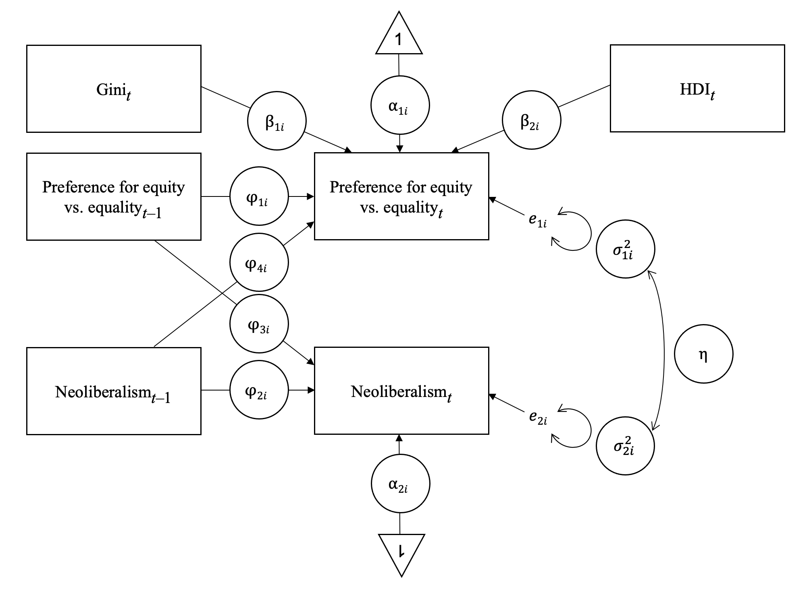
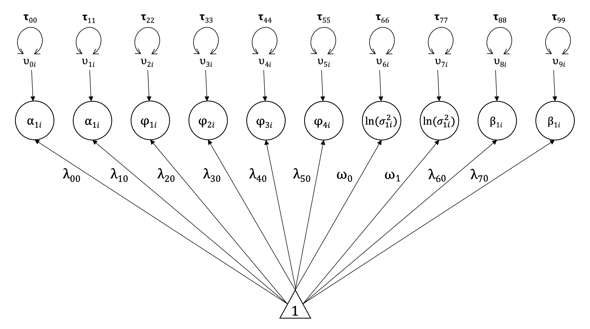
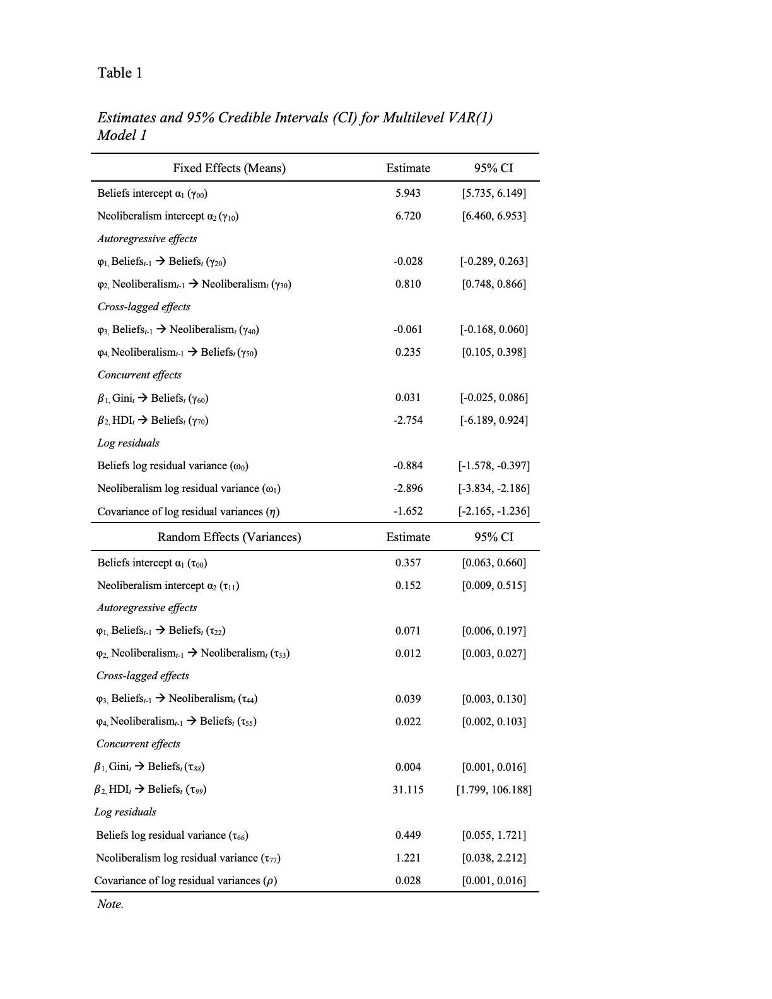
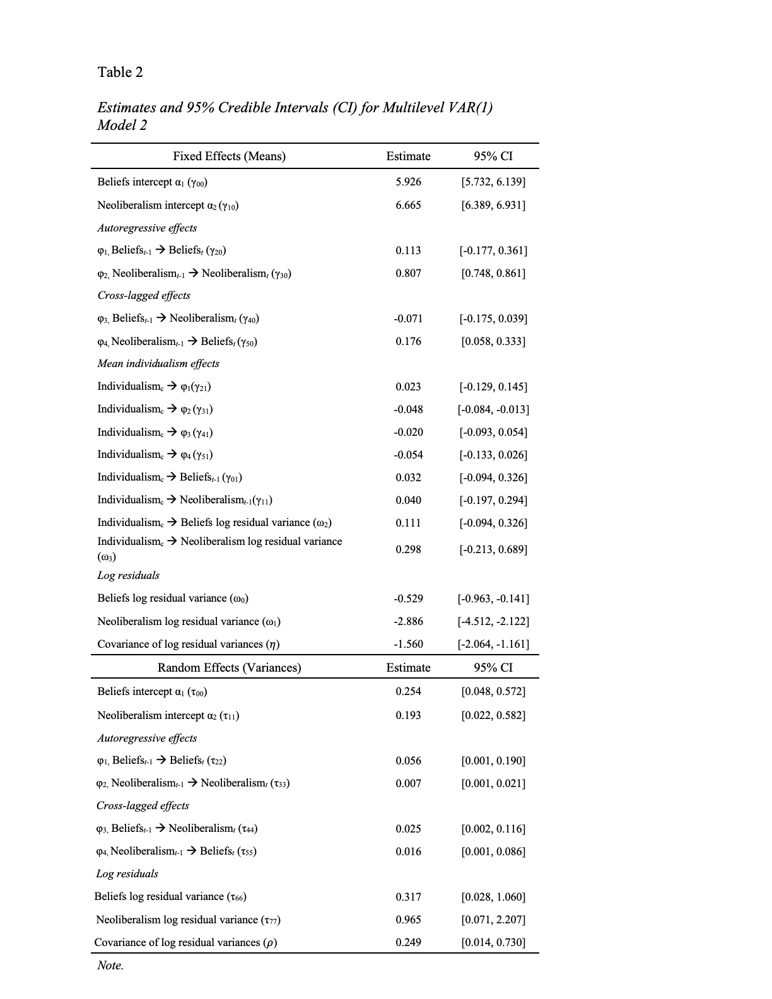
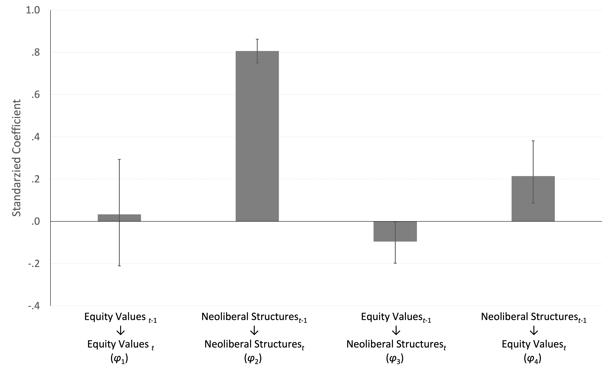

::: {.callout-note .summary appearance="simple" icon=false}
## At a glance
::: {.summary-grid}
Question
: Is there a dynamic relationship between beliefs about income inequality at the individual level and economic policies at the societal level?

Data
:  Economic policies derived from official statistics, legal data, and expert surveys

:  Attitudes toward income inequality were measured in the World Values Survey


Analysis
:   Dynamic Structural Equation Modeling to analyze longitudinal relationships between neoliberal structures and individuals’ preferences for income (in)equality in more than 160 countries over 5 waves.

Findings
:   Market-oriented economic policies predicted higher preference for income inequality a few years later.
:::
:::

## Background

Neoliberalism refers to free market policies of reduced welfare spending, privatization, and deregulation of labor markets. One reason advocates argue for enacting these policies is that they reward hard work, rather than free riding. In this project, we examined how variations in market-oriented policies relate to beliefs about income inequality in more than 160 countries over more than two decades.

## Data

**Free Market Economic policies data:** Composite of items from Fraser Institute’s Economic Freedom Index (EFI), such as government consumption, transfers and subsidies, top marginal income and payroll tax, hiring and firing regulation, centralized collective bargaining.

**Attitudes towards income inequality** survey measure from WVS with answers ranging from “Incomes should be made more equal” (1) to “There should be greater incentives for individual effort” (10) 

Analysis was conducted on five waves of data, from
WVS Waves 3 (1995–1998) through 7 (2017–2019). 

## Models

To merge the EFI and WVS data sets, we averaged our index of policies across the years containing each WVS wave.

Models have two outcome variables: neoliberal economic policies and income inequality attitudes.

In Model 1, policies and attitudes for country i at time t are predicted from policies and attitudes at the preceding measurement occasion (t – 1), while adjusting for economic development (HDI) and Gini at time t.

Model 2 included an indicator of individualism as a time-invariant covariate.


::: {layout-ncol=2}



:::

<details class="code-details"><summary>Show Mplus code: Model 1</summary>

```{r}
#| echo: false
#| class-output: mplus-output
cat(readLines("model1.inp"), sep = "\n")
```

</details>

<details class="code-details"><summary>Show Mplus code: Model 2</summary>

```{r}
#| echo: false
#| class-output: mplus-output
cat(readLines("model2.inp"), sep = "\n")
```

</details>

## Results
As shown in Table 1, Lag-1 neoliberalism predicted higher preference for income inequality at time t (φ4i), whereas Lag-1 preference for income inequality did not predict neoliberalism at time t (φ3i) when we adjusted for the time-varying effects of HDI and Gini. 








## Takeaways

::: {.takeaways}
- Data from more than 160 countries collected in the past 2 decades suggest that neoliberal systems have been instrumental in promoting preferences for income inequality

- More generally, this work provides evidence that people's beliefs about inequality are influenced by socioeconomic institutions and policies.
:::

Full code: [Model 1](model1.inp) · [Model 2](model2.inp)

**Paper:** Goudarzi, S., Badaan, V., & Knowles, E. D. (2022). Neoliberalism and the ideological construction of equity beliefs. *Perspectives on Psychological Science, 17*(5), 1–21.

[Read the paper](https://doi.org/10.1177/17456916211053311){.btn .btn-outline-primary}
