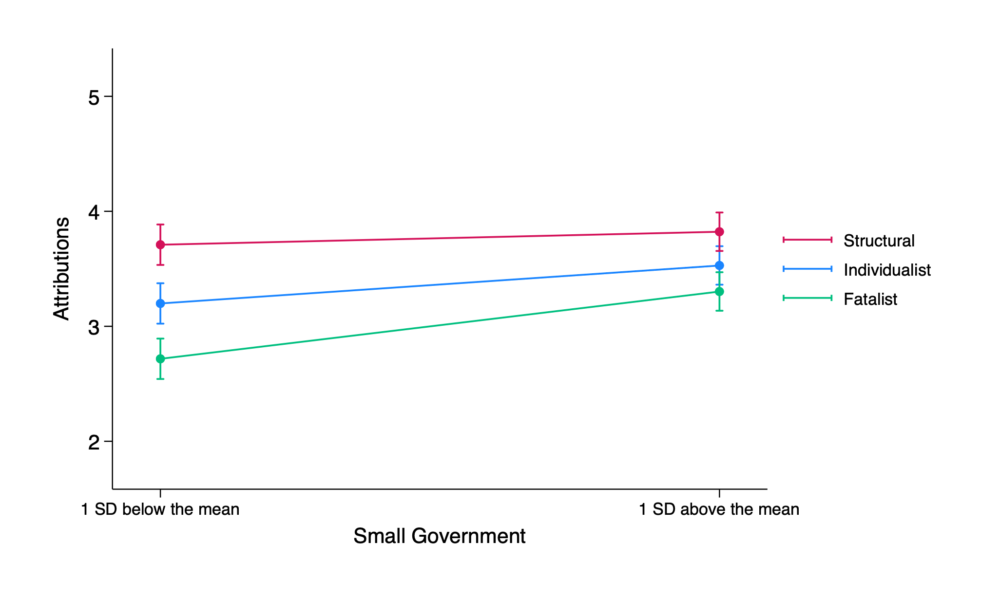
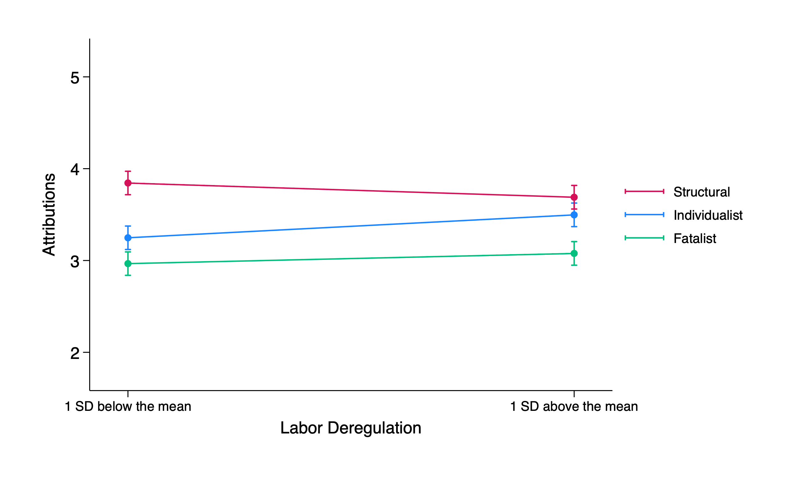

::: {.callout-note .summary appearance="simple" icon=false}
## At a glance
::: {.summary-grid}
Question
:   What do people think causes poverty, and how do these beliefs relate to welfare and labor policies?

Data
:   Survey responses fielded in 13 countries (N = 6,500 with representative samples) integrated with country-level labor and welfare policies

Methods
:   Multi-national survey study with three-level mixed-effects regression

Findings
:   Reduced government spending predicts greater endorsement of individualist and fatalist attributions, and labor deregulation predicts greater endorsement of individualist attributions.
:::
:::


## Background

Despite an abundance of economic wealth in the 21st century, poverty remains one of the challenges facing societies worldwide. Social scientists have long contended that the reasons people give for why poverty exists are related to their preferences for different policies. Little work, however, has looked at the relationship between actual policies and poverty beliefs. Our study examines three types of poverty attributions people give for why some people are poor: individualist (e.g., poor people are lazy), structural (e.g., the system is corrupt), and fatalist (e.g., poor people are unlucky). We study 13 countries, including commonly studied Western societies (e.g., the United States and the United Kingdom) and underrepresented societies (e.g., Egypt and Saudi Arabia).

## Attributions across countries

Before modeling, we compared mean endorsement of each attribution type by country.
Countries are ordered from least to most market-oriented, using the average of their
government size and labor regulation scores.

{#fig-countries}

The R code below reshapes the survey data to long format (one row per respondent ×
attribution type), computes country means with 95% confidence intervals, and draws
the plot.

<details class="code-details"><summary>Show R code</summary>

```r
library(tidyverse)
library(haven)
library(reshape2)

df1 <- read_dta("Goudarzi&Napier_2025_full.dta")

# Long format: one row per respondent x attribution type
df_att_poverty <- subset(df1, select = c("country", "respondent_serial",
                                         "ind4", "struct4", "fate3",
                                         "gov_size", "labor_reg"))
df_att_poverty_long <- melt(df_att_poverty,
                            id = c("country", "respondent_serial",
                                   "gov_size", "labor_reg"))
colnames(df_att_poverty_long)[colnames(df_att_poverty_long) == "variable"] <- "att_type"
df_att_poverty_filtered <- df_att_poverty_long %>% filter(!is.na(value))

# Country means with 95% confidence intervals
summary_data <- df_att_poverty_filtered %>%
  group_by(country, att_type) %>%
  summarise(
    mean_value = mean(value),
    ci_lower   = mean_value - qt(0.975, n()) * sd(value) / sqrt(n()),
    ci_upper   = mean_value + qt(0.975, n()) * sd(value) / sqrt(n()),
    .groups = "drop"
  )

# Order countries by the average of government size and labor regulation
order <- c("Sweden", "Brazil", "Japan", "South Korea", "Turkey", "UK", "Indonesia",
           "Hungary", "Russia", "US", "India", "Egypt", "Saudi Arabia")
country_mapping <- c("Brazil", "Egypt", "Hungary", "India", "Indonesia", "Japan",
                     "Russia", "Saudi Arabia", "South Korea", "Sweden", "Turkey",
                     "UK", "US")
summary_data$country  <- factor(country_mapping[summary_data$country], levels = order)
summary_data$att_type <- factor(summary_data$att_type,
                                levels = c("struct4", "ind4", "fate3"))

# Plot
figure1 <- ggplot(summary_data,
                  aes(x = country, y = mean_value, color = att_type,
                      group = interaction(country, att_type))) +
  geom_point(position = position_dodge(width = 0.3)) +
  geom_errorbar(aes(ymin = ci_lower, ymax = ci_upper), width = 0.1,
                position = position_dodge(width = 0.3)) +
  labs(x = "", y = "Mean Value", color = "Attribution Type") +
  scale_color_manual(values = c("red", "blue", "#4CAF50"),
                     labels = c("Structural", "Individualist", "Fatalist")) +
  scale_y_continuous(limits = c(1, 5)) +
  theme_minimal() +
  theme(axis.text.x = element_text(angle = 45, hjust = 1, size = 10),
        panel.grid.major.x = element_blank())

ggsave("figure1_lineplot.png", plot = figure1,
       width = 10, height = 7, units = "in", dpi = 300)
```

</details>

## Data and model

We fit a three-level mixed-effects regression, with attribution types (level 1) nested in respondents (level 2), nested in countries (level 3). The outcome is attribution endorsement. The model was estimated in two steps.

**Step 1: Individual-level predictors**

- Attribution type: dummy codes for individualist and fatalist (structural = reference)
- Subjective socioeconomic status (SES), centered within country
- Attribution type × SES

**Step 2: Economic policies**

- Small government
- Labor deregulation
- Attribution type × small government
- Attribution type × labor deregulation

**Controls (both steps)**

- Individual level: gender, age, college education, income
- Country level: SES (centered between countries), Gini, DI, HDI

<!-- Add your Stata model code here when ready, e.g.:

```stata
mixed endorsement i.att_type##c.small_gov i.att_type##c.labor_dereg ... || country: || respondent_serial:
margins att_type, at(small_gov = (-1 1))
marginsplot
```
-->

## Results

The figures below show predicted endorsement of each attribution type in countries
1 SD below and 1 SD above the mean on each policy measure, from the Step 2 model.

::: {layout-ncol=2}
{#fig-gov}

{#fig-labor}
:::

Predicted attribution endorsement at low (−1 SD) and high (+1 SD) levels of small government and labor deregulation (95% CI).

## Takeaways

::: {.takeaways}
- Structural attributions are the most strongly endorsed in most of the 13 countries, but the gap between attribution types varies widely across countries and is related to small government and labor laws.
- In countries with smaller governments, people more strongly endorse individualist and fatalist explanations for poverty.
- In countries with more deregulated labor markets, people more strongly endorse individualist explanations.

:::

Full code: [goudarzi-napier-2026-plots.R](goudarzi-napier-2026-plots.R)


**Paper:** Goudarzi, S., & Napier, J. L. (2026). The association between neoliberal policies and attributions of poverty in 13 countries. *Social Psychological and Personality Science, 17*(4), 480–491.

[Read the paper](https://doi.org/10.1177/19485506251370805){.btn .btn-outline-primary}
